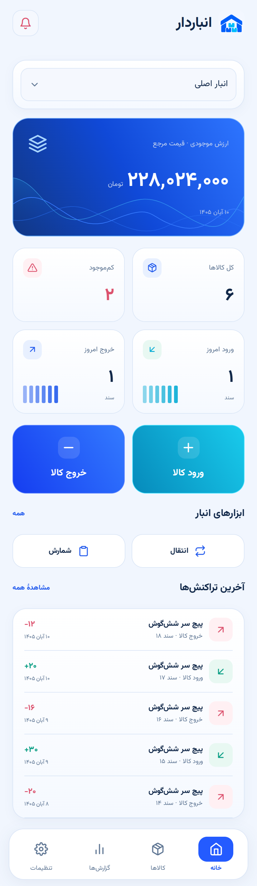
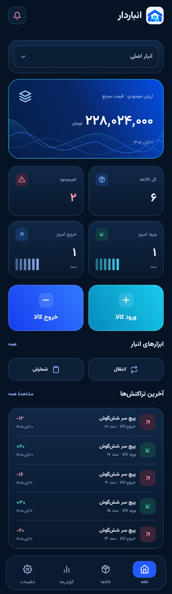
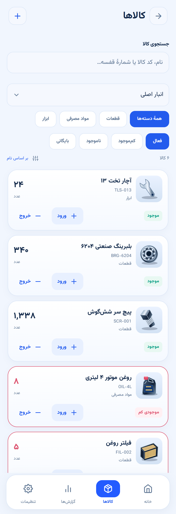
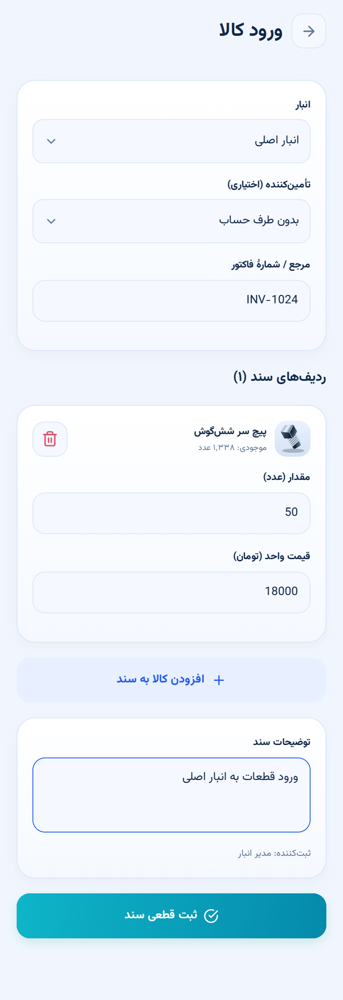
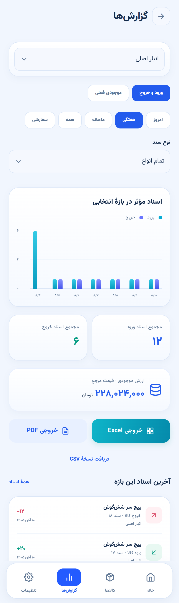
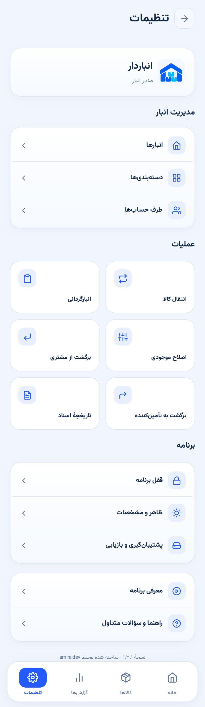
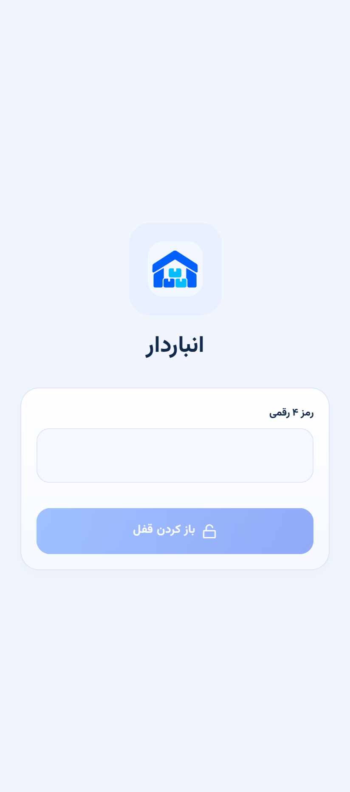

<!--
راهنمای افزودن تصاویر — این توضیح در صفحهٔ گیت‌هاب نمایش داده نمی‌شود.

این فایل را با نام README.md در ریشهٔ مخزن قرار دهید.
تصاویر خودتان را در پوشهٔ docs/images با نام‌های زیر بارگذاری کنید:

logo.png          لوگوی آبی انباردار
home-light.png    صفحهٔ اصلی در حالت روشن
home-dark.png     صفحهٔ اصلی در حالت تاریک
products.png      فهرست کالاها
stock-document.png فرم ثبت ورود یا خروج کالا
reports.png       صفحهٔ گزارش‌ها
settings.png      صفحهٔ تنظیمات
app-lock.png      صفحهٔ ورود رمز برنامه
onboarding.png    یکی از صفحات معرفی برنامه یا تصویری ترکیبی از چهار اسلاید

اگر نام یا پسوند تصویری متفاوت است، مسیر همان تصویر را در این فایل تغییر دهید.
فایل APK را در بخش Releases مخزن، به‌عنوان فایل پیوست نسخه قرار دهید.
پیوند ثابت به مخزنِ فرضی در این README استفاده نشده است؛ نام مخزن را می‌توانید آزادانه انتخاب کنید.
-->

  
  <h1>انباردار | Anbardar</h1>
  
<strong>مدیریت موجودی، ورود و خروج کالا و گزارش انبار، روی گوشی</strong>

  
فارسی و راست‌به‌چپ · استفادهٔ آفلاین · حالت روشن و تاریک

  
نسخهٔ ۱.۳.۱ — ساخته شده توسط <a href="https://github.com/amiraidev">amiraidev</a>

## دربارهٔ انباردار

**انباردار** یک برنامهٔ فارسی برای مدیریت کالاها و موجودی انبار است. با آن می‌توانید کالا تعریف کنید، ورود و خروج را ثبت کنید، موجودی چند انبار را ببینید و از گردش کالاها گزارش بگیرید.

برنامه برای فروشگاه‌ها، کارگاه‌ها و کسب‌وکارهایی طراحی شده که به ابزاری در دسترس برای پیگیری موجودی روزانه نیاز دارند. اطلاعات انبار به‌صورت محلی روی دستگاه نگهداری می‌شود و برای کارهای اصلی به اتصال دائمی اینترنت نیاز ندارید.

برای دریافت فایل نصب اندروید، بخش **Releases** همین مخزن را باز کنید و فایل **APK** نسخهٔ موردنظر را دانلود کنید.

## نگاهی به محیط برنامه

### صفحهٔ اصلی؛ وضعیت انبار در یک نگاه

موجودی، ارزش برآوردی کالاها، هشدار کمبود و تعداد اسناد ورود و خروج امروز را ببینید. با انتخاب انبار، آمار همان انبار نمایش داده می‌شود و دکمه‌های ورود و خروج، ثبت عملیات روزانه را در دسترس قرار می‌دهند.

| حالت روشن | حالت تاریک |
| :---: | :---: |
|  |  |

### کالاها و ثبت عملیات

در فهرست کالاها، نام یا کد کالا را جستجو کنید و بر اساس دسته‌بندی یا وضعیت موجودی فیلتر بگذارید. برای افزایش یا کاهش موجودی، سند ثبت کنید تا سابقهٔ هر تغییر باقی بماند.

| فهرست کالاها | ثبت سند ورود یا خروج |
| :---: | :---: |
|  |  |
| مشاهدهٔ کد، دسته و موجودی کالا؛ دسترسی به جزئیات و عملیات | انتخاب انبار، افزودن چند کالا، تعیین مقدار و ثبت قطعی سند |

### گزارش‌ها و تنظیمات

گزارش گردش کالا را برای انبار و بازهٔ زمانی دلخواه تهیه کنید. ابزارهای مدیریت انبار، طرف حساب‌ها، پشتیبان‌گیری، پوسته و قفل برنامه نیز از تنظیمات در دسترس‌اند.

| گزارش‌ها | تنظیمات |
| :---: | :---: |
|  |  |
| بازهٔ شمسی، فیلتر نوع سند، نمودار و خروجی فایل | مدیریت انبارها، دسته‌ها، طرف حساب‌ها و تنظیمات برنامه |

### قفل برنامه و راهنمای شروع

می‌توانید برای ورود به برنامه رمز عددی چهاررقمی تعیین کنید. در شروع نیز معرفی چهاراسلایدی و راهنمای شش‌مرحله‌ای کمک می‌کنند با بخش‌های اصلی آشنا شوید. معرفی و راهنما از تنظیمات دوباره قابل اجرا هستند.

| قفل چهاررقمی | معرفی برنامه |
| :---: | :---: |
|  |  |

## امکانات

### مدیریت کالاها

- تعریف و ویرایش کالا با نام، کد یکتا، دسته‌بندی و عکس از گالری.
- تعیین واحد سنجش، حد هشدار کمبود، قیمت خرید مرجع و قیمت فروش.
- ثبت محل قرارگیری کالا در قفسه و یادداشت.
- پشتیبانی از مقدارهای اعشاری تا سه رقم و ورود اعداد فارسی یا انگلیسی.
- جستجو، مرتب‌سازی و فیلتر کالاهای فعال، کم‌موجود، ناموجود و بایگانی‌شده.
- بایگانی کالای بدون موجودی با حفظ سوابق و امکان فعال‌سازی دوباره.

### انبارها و طرف حساب‌ها

- تعریف چند انبار و مشاهدهٔ موجودی هرکدام.
- انتقال کالا بین انبار مبدأ و مقصد.
- مدیریت مشتریان و تأمین‌کنندگان.
- ثبت طرف حساب، مرجع، یادداشت و نام ثبت‌کننده در اسناد مرتبط.

### اسناد و گردش موجودی

| عملیات | کاربرد |
| --- | --- |
| ورود کالا | افزایش موجودی و ثبت موجودی اولیه |
| خروج کالا | کاهش موجودی و ثبت حوالهٔ خروج |
| انتقال | جابه‌جایی موجودی بین دو انبار |
| برگشت از مشتری | بازگرداندن کالا به موجودی انبار |
| برگشت به تأمین‌کننده | ثبت مرجوعی و کاهش موجودی |
| اصلاح موجودی | ثبت افزایش یا کاهش با درج علت |
| انبارگردانی | ثبت مقدار شمارش‌شده و محاسبهٔ اختلاف |
| ابطال سند | ثبت سند معکوس با حفظ سابقهٔ سند اصلی |

هر سند می‌تواند چند ردیف کالا داشته باشد. برنامه موجودی کافی، تکراری‌نبودن ردیف‌ها و معتبر بودن اطلاعات سند را بررسی می‌کند. هنگام انبارگردانی نیز تغییر موجودی پس از شروع شمارش کنترل می‌شود.

### گزارش و انتقال اطلاعات

- گزارش گردش کالا با انتخاب انبار، نوع سند و بازهٔ زمانی.
- پشتیبانی از تاریخ شمسی و بازهٔ سفارشی.
- نمودار تعداد اسناد مؤثر ورود و خروج در بازهٔ انتخابی.
- مشاهدهٔ موجودی فعلی و ارزش برآوردی آن بر اساس قیمت خرید مرجع.
- خروجی **Excel با فرمت XLSX**، **CSV** و **PDF**؛ امکان چاپ سند.
- ورود گروهی مشخصات کالاها از CSV.
- تهیه و بازیابی پشتیبان **JSON** شامل کالاها، تصاویر، اسناد و تنظیمات.

### تجربهٔ کاربری

- رابط فارسی و راست‌به‌چپ.
- پوستهٔ روشن، تاریک و هماهنگ با تنظیمات دستگاه.
- انیمیشن نرم منوی پایین و گزینهٔ کاهش حرکت.
- معرفی چهاراسلایدی، راهنمای شش‌مرحله‌ای و سؤالات متداول.
- قفل اختیاری چهاررقمی، تغییر رمز، غیرفعال‌سازی و قفل فوری.

## نصب روی اندروید

۱. بخش **Releases** همین مخزن را باز کنید.
۲. فایل دارای پسوند `.apk` نسخهٔ موردنظر را دانلود کنید.
۳. فایل را روی گوشی باز کنید.
۴. اگر اندروید درخواست کرد، مجوز نصب را برای همان مرورگر یا فایل‌منیجر فعال کنید.
۵. نصب را کامل و برنامهٔ **انباردار** را اجرا کنید.

نسخهٔ نصب‌شده از APK مستقل اجرا می‌شود؛ برای استفاده از آن به **Expo Go، Node.js یا روشن‌بودن کامپیوتر نیاز ندارید**.

برای به‌روزرسانی، APK نسخهٔ جدید را روی نسخهٔ قبلی نصب کنید. پیش از به‌روزرسانی از اطلاعاتتان پشتیبان بگیرید. برنامه را برای نصب نسخهٔ جدید حذف نکنید؛ حذف برنامه ممکن است اطلاعات محلی را از بین ببرد.

## شروع کار در چند قدم

۱. معرفی و راهنمای اولیه را ببینید یا رد کنید.
۲. از **تنظیمات ← ظاهر و مشخصات**، نام کسب‌وکار و ثبت‌کننده را وارد کنید.
۳. در بخش **کالاها**، دسته‌بندی و اولین کالای خود را بسازید.
۴. با **ورود کالا**، موجودی اولیه را در انبار موردنظر ثبت کنید.
۵. ورود، خروج و دیگر تغییرات موجودی را با سند ثبت کنید.
۶. از بخش **گزارش‌ها** وضعیت انبار را بررسی و خروجی تهیه کنید.
۷. از **تنظیمات ← پشتیبان‌گیری و بازیابی**، فایل پشتیبان را خارج از برنامه ذخیره کنید.

برنامه با انبار خالی شروع می‌شود؛ موجودی اولیه را خودتان ثبت می‌کنید.

## نگهداری اطلاعات و قفل برنامه

اطلاعات انبار روی دستگاه ذخیره می‌شود. برای جلوگیری از ازدست‌رفتن اطلاعات در صورت خرابی گوشی یا حذف برنامه، به‌طور منظم پشتیبان JSON تهیه و در محل دیگری نگهداری کنید.

قفل چهاررقمی، ورود به رابط برنامه را محدود می‌کند و پس از رفتن برنامه به پس‌زمینه دوباره فعال می‌شود. این قفل، دیتابیس انبار یا فایل پشتیبان JSON را رمزگذاری نمی‌کند. رمز در پشتیبان ذخیره نمی‌شود و بازیابی پشتیبان نیز رمز فعلی برنامه را تغییر نمی‌دهد.

## سؤالات متداول

**برنامه بدون اینترنت کار می‌کند؟**  
بله؛ ثبت کالا، عملیات موجودی و گزارش‌های محلی به اتصال دائمی اینترنت نیاز ندارند.

**می‌توانم هم‌زمان روی چند گوشی کار کنم؟**  
در نسخهٔ فعلی، همگام‌سازی زنده بین دستگاه‌ها وجود ندارد. انتقال دستی اطلاعات با فایل پشتیبان امکان‌پذیر است. بازیابی، اطلاعات فعلی دستگاه مقصد را جایگزین می‌کند.

**می‌توانم سند قطعی را ویرایش یا حذف کنم؟**  
اسناد قطعی بازنویسی یا حذف نمی‌شوند. برای اصلاح از سند جدید یا ابطال با ثبت سند معکوس استفاده کنید تا سابقه حفظ شود.

**چرا خروج کالا ثبت نمی‌شود؟**  
موجودی همان انبار باید کافی باشد. اگر کالا در انبار دیگری قرار دارد، ابتدا آن را منتقل کنید.

**گزارش ارزش موجودی همان سود یا بهای تمام‌شده است؟**  
خیر؛ ارزش موجودی با قیمت خرید مرجع فعلی کالا محاسبه می‌شود. این نسخه سامانهٔ حسابداری دوبل، محاسبهٔ سود قطعی یا ارزش‌گذاری FIFO و میانگین موزون نیست.

**رمز برنامه قابل بازیابی است؟**  
خیر؛ رمز فعلی قابل بازیابی نیست. پیش از فعال‌سازی قفل، از اطلاعات انبار پشتیبان تهیه کنید.

## فناوری ساخت

| بخش | فناوری |
| --- | --- |
| رابط برنامه | React Native و TypeScript |
| بستر توسعه و ساخت | Expo |
| ذخیره‌سازی محلی نسخهٔ موبایل | SQLite |
| نگهداری اطلاعات قفل در موبایل | Expo SecureStore |

این صفحه برنامه و امکاناتش را معرفی می‌کند. فایل‌های نصب اندروید از بخش **Releases** همین مخزن دریافت می‌شوند.

## گزارش مشکل و پیشنهاد

برای گزارش اشکال یا پیشنهاد قابلیت، در بخش **Issues** همین مخزن پیام بگذارید. ذکر موارد زیر به بررسی دقیق‌تر کمک می‌کند:

- نسخهٔ برنامه، مدل گوشی و نسخهٔ اندروید.
- مراحلی که باعث بروز مشکل می‌شوند.
- نتیجهٔ موردانتظار و اتفاقی که واقعاً رخ داده است.
- تصویر مرتبط یا متن خطا، در صورت امکان.

---

  
<strong>ساخته شده توسط <a href="https://github.com/amiraidev">amiraidev</a></strong>

  
<a href="https://amiraidev.ir">وب‌سایت</a> · <a href="https://github.com/amiraidev">گیت‌هاب</a>

