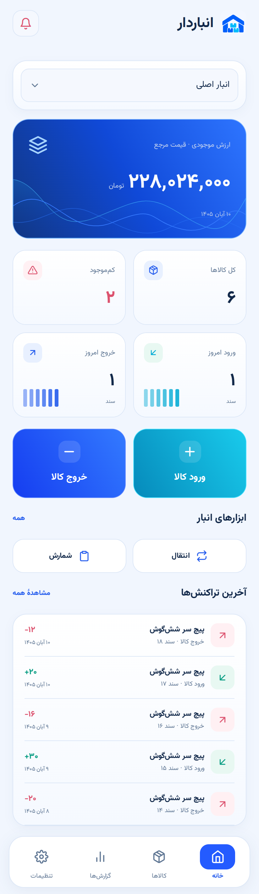
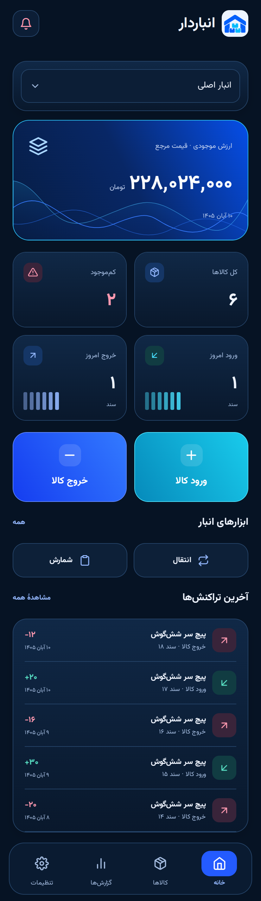
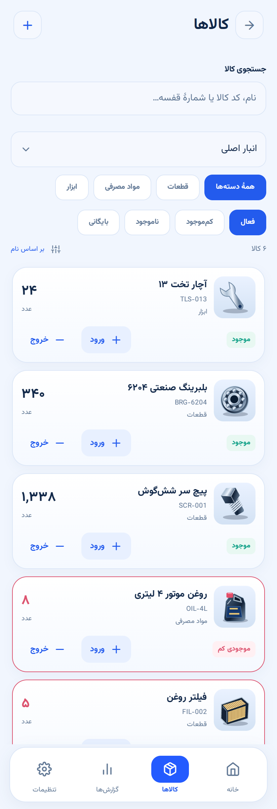
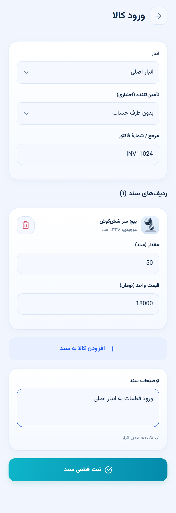
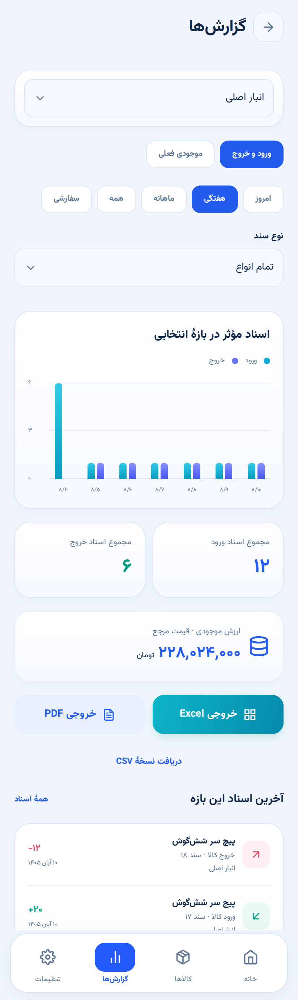
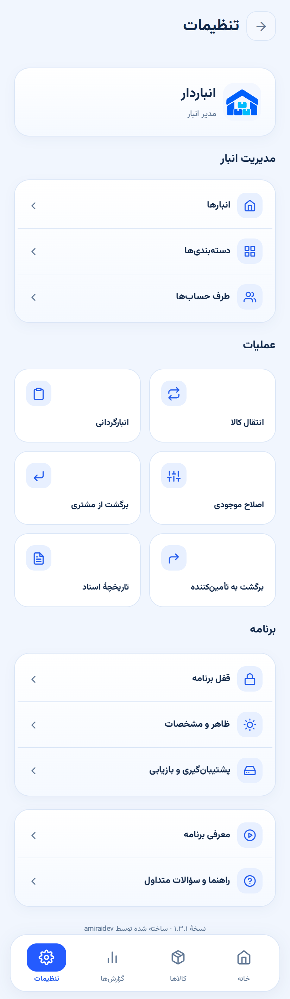
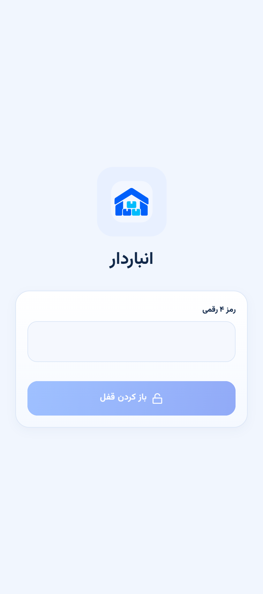

<!--
تصاویر معرفی برنامه در docs/images و لوگو در assets/brand-logo.png قرار دارند.
فایل APK هر نسخه را به‌عنوان پیوست در بخش Releases مخزن قرار دهید.
-->

  
  <h1>انباردار | Anbardar</h1>
  
<strong>انبارداری ساده و دقیق</strong>

  
مدیریت موجودی، ورود و خروج کالا و گزارش انبار، روی گوشی

  
فارسی و راست‌به‌چپ · استفادهٔ آفلاین · حالت روشن و تاریک

  
نسخهٔ ۱.۴.۰ · ساخته‌شده توسط <a href="https://github.com/amiraidev">amiraidev</a>

## دربارهٔ انباردار

**انباردار** یک برنامهٔ فارسی برای مدیریت کالاها و موجودی انبار است. با آن می‌توانید کالا تعریف کنید، ورود و خروج را ثبت کنید، موجودی چند انبار را ببینید و از گردش کالاها گزارش بگیرید.

برنامه برای فروشگاه‌ها، کارگاه‌ها و کسب‌وکارهایی طراحی شده که به ابزاری در دسترس برای پیگیری موجودی روزانه نیاز دارند. اطلاعات انبار به‌صورت محلی روی دستگاه نگهداری می‌شود و کارهای اصلی به اینترنت نیاز ندارند.

برای دریافت فایل نصب اندروید، بخش **Releases** همین مخزن را باز کنید و فایل **APK** نسخهٔ موردنظر را دانلود کنید.

## تازه‌های نسخهٔ ۱.۴.۰

- کد کالا (SKU) در فرم ثبت دستی اختیاری شد. اگر کد وارد کنید، باید یکتا باشد.
- امکان ثبت برند و مدل و جست‌وجو بر اساس آن‌ها اضافه شد.
- دسته‌بندی تازه را می‌توانید از داخل فرم کالا بسازید. دستهٔ جدید خودکار انتخاب می‌شود.
- فلش‌های بالا و پایین کنار مقدار ردیف‌های سند و حد هشدار کمبود اضافه شدند. ورود مستقیم عدد همچنان در دسترس است.
- هنگام باز شدن صفحه‌کلید، فرم جابه‌جا می‌شود تا کادر فعال و متن در حال تایپ قابل مشاهده باشند.
- رفتار قفل پس از بازگشت به برنامه بهبود یافت و فرم نیمه‌کاره پس از باز کردن قفل حفظ می‌شود.
- حجم APK مخصوص ARM از حدود ۸۸ مگابایت در بستهٔ قبلی به حدود ۴۶ مگابایت رسید.

## نگاهی به محیط برنامه

### صفحهٔ اصلی و وضعیت انبار

خلاصهٔ کالاها، ارزش برآوردی موجودی، هشدار کمبود و تعداد اسناد ورود و خروج امروز را ببینید. با انتخاب انبار، آمار همان انبار نمایش داده می‌شود و دکمه‌های ورود و خروج، ثبت عملیات روزانه را در دسترس قرار می‌دهند.

| حالت روشن | حالت تاریک |
| :---: | :---: |
|  |  |

### کالاها و ثبت عملیات

در فهرست کالاها، نام، کد، برند، مدل یا قفسه را جست‌وجو کنید و بر اساس دسته‌بندی یا وضعیت موجودی فیلتر بگذارید. برای افزایش یا کاهش موجودی، سند ثبت کنید تا سابقهٔ هر تغییر باقی بماند.

| فهرست کالاها | ثبت سند ورود یا خروج |
| :---: | :---: |
|  |  |
| مشاهدهٔ مشخصات و موجودی کالا و دسترسی به عملیات | انتخاب انبار، افزودن چند کالا، تعیین مقدار و ثبت قطعی سند |

### گزارش‌ها و تنظیمات

گزارش گردش کالا را برای انبار و بازهٔ زمانی دلخواه تهیه کنید. ابزارهای مدیریت انبار، طرف حساب‌ها، پشتیبان‌گیری، پوسته و قفل برنامه نیز از تنظیمات در دسترس‌اند.

| گزارش‌ها | تنظیمات |
| :---: | :---: |
|  |  |
| بازهٔ شمسی، فیلتر نوع سند، نمودار و خروجی فایل | مدیریت انبارها، دسته‌ها، طرف حساب‌ها و تنظیمات برنامه |

### قفل برنامه و راهنمای شروع

می‌توانید برای ورود به برنامه رمز عددی چهاررقمی تعیین کنید. در شروع نیز معرفی چهاراسلایدی و راهنمای شش‌مرحله‌ای کمک می‌کنند با بخش‌های اصلی آشنا شوید. معرفی و راهنما از تنظیمات دوباره قابل اجرا هستند.

| قفل چهاررقمی | معرفی برنامه |
| :---: | :---: |
|  |  |

## امکانات

### مدیریت کالاها

- تعریف و ویرایش کالا با نام، کد اختیاری، برند، مدل، دسته‌بندی و عکس از گالری.
- ساخت دسته‌بندی و انتخاب خودکار آن از داخل فرم کالا.
- تعیین واحد سنجش، حد هشدار کمبود، قیمت خرید مرجع و قیمت فروش.
- ثبت محل قرارگیری کالا در قفسه و یادداشت.
- تایپ مقدار با ارقام فارسی یا انگلیسی و حداکثر سه رقم اعشار.
- تنظیم مقدار ردیف سند و حد هشدار کمبود با فلش‌های بالا و پایین.
- جست‌وجو، مرتب‌سازی و فیلتر کالاهای فعال، کم‌موجود، ناموجود و بایگانی‌شده.
- بایگانی کالای بدون موجودی با حفظ سوابق و امکان فعال‌سازی دوباره.

### انبارها و طرف حساب‌ها

- تعریف چند انبار و مشاهدهٔ موجودی هرکدام.
- انتقال کالا بین انبار مبدأ و مقصد.
- مدیریت مشتریان و تأمین‌کنندگان.
- ثبت طرف حساب، مرجع، یادداشت و نام ثبت‌کننده در اسناد مرتبط.

### اسناد و گردش موجودی

| عملیات | کاربرد |
| --- | --- |
| ورود کالا | افزایش موجودی و ثبت موجودی اولیه |
| خروج کالا | کاهش موجودی و ثبت حوالهٔ خروج |
| انتقال | جابه‌جایی موجودی بین دو انبار |
| برگشت از مشتری | بازگرداندن کالا به موجودی انبار |
| برگشت به تأمین‌کننده | ثبت مرجوعی و کاهش موجودی |
| اصلاح موجودی | ثبت افزایش یا کاهش با درج علت |
| انبارگردانی | ثبت مقدار شمارش‌شده و محاسبهٔ اختلاف |
| ابطال سند | ثبت سند معکوس با حفظ سابقهٔ سند اصلی |

هر سند می‌تواند چند ردیف کالا داشته باشد. برنامه موجودی کافی، تکراری‌نبودن ردیف‌ها و معتبر بودن اطلاعات سند را بررسی می‌کند. هنگام انبارگردانی نیز تغییر موجودی پس از شروع شمارش کنترل می‌شود.

### گزارش و انتقال اطلاعات

- گزارش گردش کالا با انتخاب انبار، نوع سند و بازهٔ زمانی.
- پشتیبانی از تاریخ شمسی و بازهٔ سفارشی.
- نمودار تعداد اسناد مؤثر ورود و خروج در بازهٔ انتخابی.
- مشاهدهٔ موجودی فعلی و ارزش برآوردی آن بر اساس قیمت خرید مرجع.
- خروجی **Excel (XLSX)**، **CSV** و **PDF** و امکان چاپ سند.
- ورود گروهی مشخصات کالاها از CSV با کد کالا.
- تهیه و بازیابی پشتیبان **JSON** شامل کالاها، تصاویر، اسناد و تنظیمات.

### تجربهٔ کاربری

- رابط فارسی و راست‌به‌چپ.
- پوستهٔ روشن، تاریک و هماهنگ با تنظیمات دستگاه.
- انیمیشن منوی پایین و گزینهٔ کاهش حرکت.
- معرفی چهاراسلایدی، راهنمای شش‌مرحله‌ای و سؤالات متداول.
- قفل اختیاری چهاررقمی، تغییر رمز، غیرفعال‌سازی و قفل فوری.

## نصب روی اندروید

1. بخش **Releases** همین مخزن را باز کنید.
2. فایل دارای پسوند `.apk` نسخهٔ موردنظر را دانلود کنید. فایل سبک ۱.۴.۰ برای معماری‌های `arm64-v8a` و `armeabi-v7a` ساخته شده است.
3. فایل را روی گوشی باز کنید.
4. اگر اندروید درخواست کرد، مجوز نصب را برای همان مرورگر یا فایل‌منیجر فعال کنید.
5. نصب را کامل و برنامهٔ **انباردار** را اجرا کنید.

نسخهٔ نصب‌شده از APK مستقل اجرا می‌شود.

برای به‌روزرسانی، ابتدا پشتیبان بگیرید و APK جدید را روی نصب فعلی نصب کنید. حذف برنامه ممکن است اطلاعات محلی را از بین ببرد.

## شروع کار در چند قدم

1. معرفی و راهنمای اولیه را ببینید یا رد کنید.
2. از **تنظیمات ← ظاهر و مشخصات**، نام کسب‌وکار و ثبت‌کننده را وارد کنید.
3. در بخش **کالاها**، دسته‌بندی و اولین کالای خود را بسازید.
4. با **ورود کالا**، موجودی اولیه را در انبار موردنظر ثبت کنید.
5. ورود، خروج و دیگر تغییرات موجودی را با سند ثبت کنید.
6. از بخش **گزارش‌ها** وضعیت انبار را بررسی و خروجی تهیه کنید.
7. از **تنظیمات ← پشتیبان‌گیری و بازیابی**، فایل پشتیبان را خارج از برنامه ذخیره کنید.

برنامه با انبار خالی شروع می‌شود و موجودی اولیه را خودتان ثبت می‌کنید.

## نگهداری اطلاعات و قفل برنامه

اطلاعات انبار روی دستگاه ذخیره می‌شود. برای بازیابی داده در صورت خرابی گوشی یا حذف برنامه، به‌طور منظم پشتیبان JSON تهیه و در محل دیگری نگهداری کنید.

قفل چهاررقمی ورود به رابط برنامه را محدود می‌کند و پس از رفتن برنامه به پس‌زمینه دوباره فعال می‌شود. فایل پشتیبان و پایگاه دادهٔ انبار بدون رمزگذاری این قفل ذخیره می‌شوند. رمز جداگانه نگهداری می‌شود و بازیابی پشتیبان، رمز فعلی دستگاه را حفظ می‌کند.

## سؤالات متداول

**برنامه بدون اینترنت کار می‌کند؟** 
بله. ثبت کالا، عملیات موجودی و گزارش‌های محلی به اینترنت نیاز ندارند.

**می‌توانم هم‌زمان روی چند گوشی کار کنم؟** 
اطلاعات هر گوشی جدا ذخیره می‌شود. برای انتقال دستی از فایل پشتیبان استفاده کنید. بازیابی، اطلاعات فعلی دستگاه مقصد را جایگزین می‌کند.

**می‌توانم سند قطعی را ویرایش یا حذف کنم؟** 
برای اصلاح سند قطعی، سند تازه ثبت کنید یا با ثبت سند معکوس آن را ابطال کنید تا سابقه حفظ شود.

**چرا خروج کالا ثبت نمی‌شود؟** 
موجودی همان انبار باید کافی باشد. اگر کالا در انبار دیگری قرار دارد، ابتدا آن را منتقل کنید.

**گزارش ارزش موجودی چگونه محاسبه می‌شود؟** 
ارزش موجودی بر اساس قیمت خرید مرجع فعلی هر کالا و تعداد موجود آن محاسبه می‌شود.

**رمز برنامه قابل بازیابی است؟** 
رمز فعلی قابل بازیابی نیست. پیش از فعال‌سازی قفل، از اطلاعات انبار پشتیبان تهیه کنید.

## فناوری ساخت

| بخش | فناوری |
| --- | --- |
| رابط برنامه | React Native و TypeScript |
| بستر توسعه و ساخت | Expo |
| ذخیره‌سازی محلی نسخهٔ موبایل | SQLite |
| نگهداری اطلاعات قفل در موبایل | Expo SecureStore |

جزئیات توسعه، ساخت APK و مهاجرت اطلاعات در [راهنمای فنی فارسی](README.fa.md) و [راهنمای به‌روزرسانی](UPDATE.fa.md) آمده است.

## گزارش مشکل و پیشنهاد

برای گزارش اشکال یا پیشنهاد قابلیت، در بخش **Issues** همین مخزن پیام بگذارید. این موارد به بررسی کمک می‌کنند:

- نسخهٔ برنامه، مدل گوشی و نسخهٔ اندروید.
- مراحلی که باعث بروز مشکل می‌شوند.
- نتیجهٔ موردانتظار و اتفاقی که رخ داده است.
- تصویر مرتبط یا متن خطا، در صورت امکان.

---

  
<strong>ساخته‌شده توسط <a href="https://github.com/amiraidev">amiraidev</a></strong>

  
<a href="https://amiraidev.ir">وب‌سایت</a> · <a href="https://github.com/amiraidev">گیت‌هاب</a>

